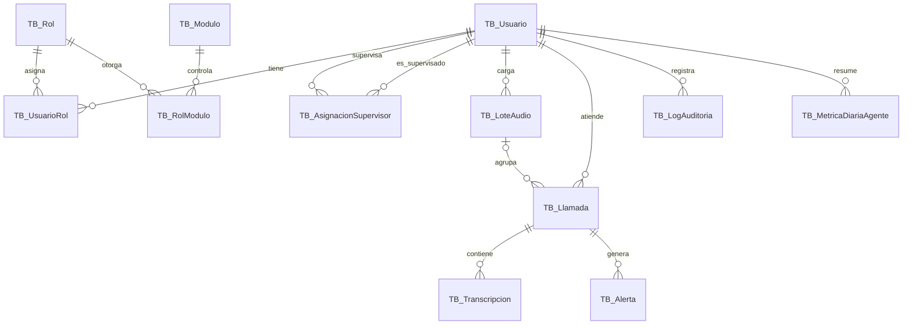

# Modelo de datos - VocalAnalytics

Base de datos: `db_vocalanalytics` (MySQL 8.0, InnoDB, utf8mb4).
Scripts: `database/01_esquema.sql`, `database/02_datos_iniciales.sql`, `database/03_verificacion.sql`.

## Diagrama entidad-relacion



## Equivalencia con el Diccionario de Datos del Blueprint

El Blueprint usa nombres en plural y minuscula. El proyecto adopta la
convencion `TB_` + singular (Prompt Maestro, seccion 9). Las columnas
conservan los nombres del Blueprint.

| Blueprint                | Tabla del proyecto        |
|--------------------------|---------------------------|
| usuarios                 | TB_Usuario                |
| roles                    | TB_Rol                    |
| roles_usuario            | TB_UsuarioRol             |
| Asignaciones_supervisor  | TB_AsignacionSupervisor   |
| llamadas                 | TB_Llamada                |
| transcripciones_llamadas | TB_Transcripcion          |
| alertas llamada          | TB_Alerta                 |
| logs auditoria           | TB_LogAuditoria           |
| metricas diarias agente  | TB_MetricaDiariaAgente    |

## Tablas y columnas agregadas, con su justificacion

El Diccionario de Datos no cubre todo lo que piden otras secciones del mismo
Blueprint. Se agregaron solo estas piezas:

| Elemento agregado | Requisito que lo justifica |
|---|---|
| TB_Modulo | Blueprint 3.1: el SuperAdmin "activa o desactiva menus y modulos dinamicamente". |
| TB_RolModulo | Historia 2 / CU-02: el SuperAdmin marca permisos por modulo (ej. "solo lectura en Reportes"); el diccionario no tenia donde guardarlos. |
| TB_LoteAudio | Seccion 3.2.1: el endpoint devuelve `id_lote` y `total_archivos` para lotes de 5, 10 o 15 audios. |
| TB_Llamada.estado_procesamiento y mensaje_error | El procesamiento de un audio no es instantaneo (Whisper); la interfaz necesita saber si esta pendiente, en proceso, terminado o con error. |
| TB_Llamada.baja_confianza_audio | Flujo alternativo E1 de la Historia 1 (ruido extremo). |
| TB_Llamada.hash_archivo | Detectar audios duplicados (Prompt Maestro, seccion 6, punto 9). |
| TB_Llamada.nombre_archivo_original | Mostrar al usuario que archivo corresponde a cada llamada. |

El tamano maximo del lote (15) y del archivo (25 MB) NO esta fijo en la base de
datos: son configuracion del backend (`.env`).

## Notas de normalizacion (3FN)

- Roles y permisos estan en tablas aparte; no hay listas de valores dentro de una columna.
- `TB_MetricaDiariaAgente` es una tabla de **resumen**: sus valores se pueden
  calcular desde `TB_Llamada`. Esta en el Blueprint para acelerar el panel del
  agente y los reportes, y la mantiene el backend. Es una desnormalizacion
  intencional y documentada.
- Que `id_supervisor` tenga rol SUPERVISOR e `id_agente` tenga rol AGENTE no
  se puede garantizar con una clave foranea; lo valida el backend.

## Como aplicarlo con phpMyAdmin (Wamp)

1. Inicie Wamp (icono verde) y abra http://localhost/phpmyadmin.
2. Pestana **SQL**. Abra `database/01_esquema.sql` con el Bloc de notas o VS Code,
   copie todo el contenido, peguelo y pulse **Continuar**.
3. Repita con `02_datos_iniciales.sql`.
4. Repita con `03_verificacion.sql` y compare con los resultados esperados que
   indican los comentarios del archivo.

## Pruebas de integridad manuales

Ejecute cada sentencia por separado en la pestana SQL de la base
`db_vocalanalytics`. Todas deben **fallar** con el error indicado; si alguna
se ejecuta con exito, avise al equipo.

```sql
-- 1) Correo duplicado -> error 1062 (Duplicate entry)
INSERT INTO TB_Usuario (nombre_completo, correo_electronico, password_hash)
VALUES ('Prueba Uno', 'prueba@ejemplo.com', 'hash-falso');
INSERT INTO TB_Usuario (nombre_completo, correo_electronico, password_hash)
VALUES ('Prueba Dos', 'prueba@ejemplo.com', 'hash-falso');

-- 2) Llamada de un agente que no existe -> error 1452 (foreign key)
INSERT INTO TB_Llamada (id_agente) VALUES (999999);

-- 3) Puntaje fuera de rango -> error 3819 (check constraint violated)
INSERT INTO TB_Llamada (id_agente, puntaje_final)
SELECT id_usuario, 150.00 FROM TB_Usuario WHERE correo_electronico = 'prueba@ejemplo.com';

-- 4) Escribir sin poder leer -> error 3819
INSERT INTO TB_RolModulo (id_rol, id_modulo, puede_leer, puede_escribir)
SELECT 1, 1, 0, 1;
```

Limpieza de la prueba 1 (dejar la base como estaba):

```sql
DELETE FROM TB_Usuario WHERE correo_electronico = 'prueba@ejemplo.com';
```

## Reiniciar la base en desarrollo (borra TODOS los datos)

Solo para su computadora de desarrollo, nunca con datos que quiera conservar.
En phpMyAdmin, pestana SQL:

```sql
DROP DATABASE IF EXISTS db_vocalanalytics;
```

Luego vuelva a ejecutar `01_esquema.sql` y `02_datos_iniciales.sql`.
